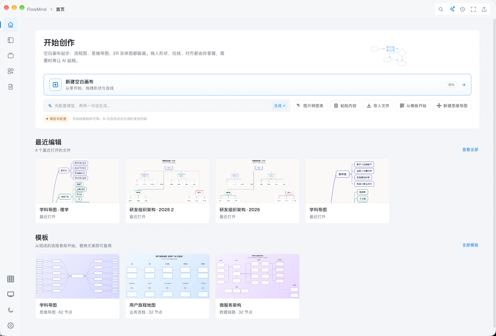
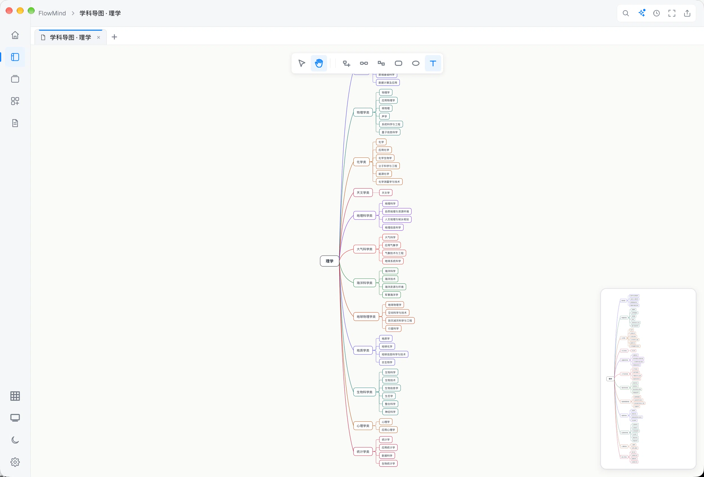
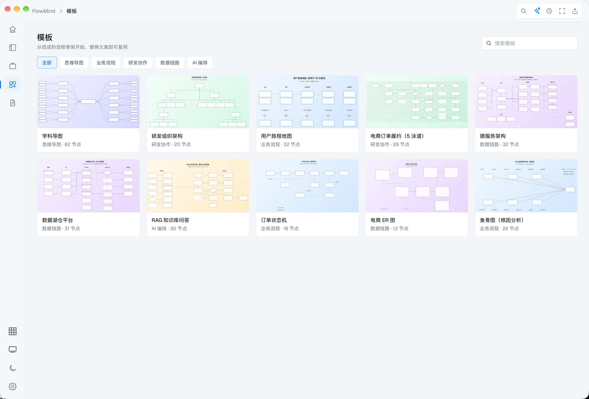
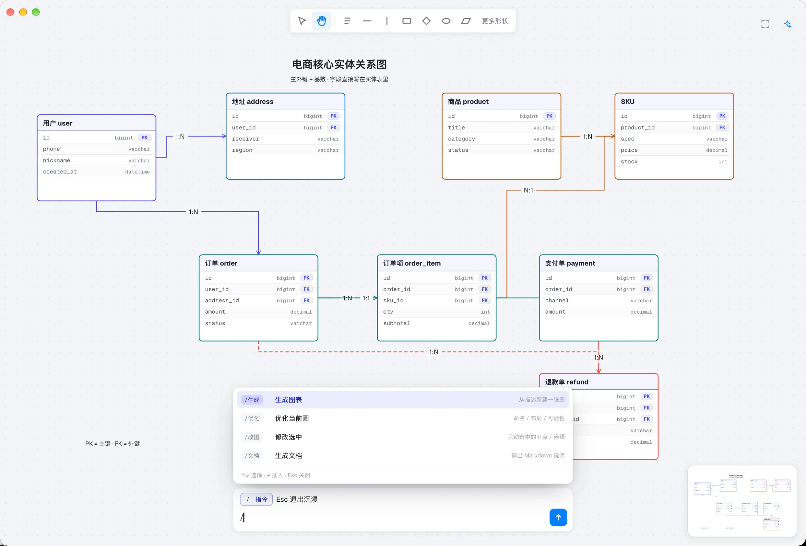
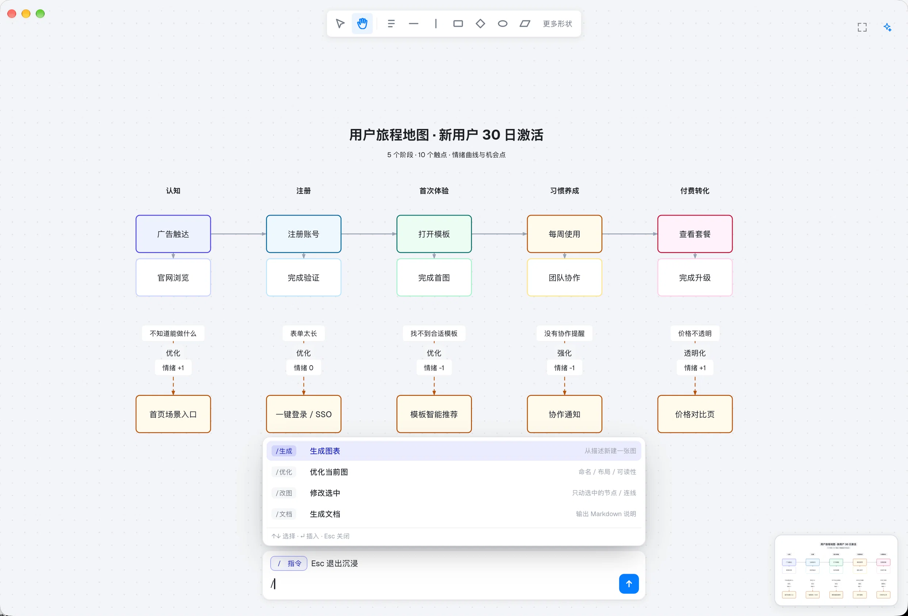
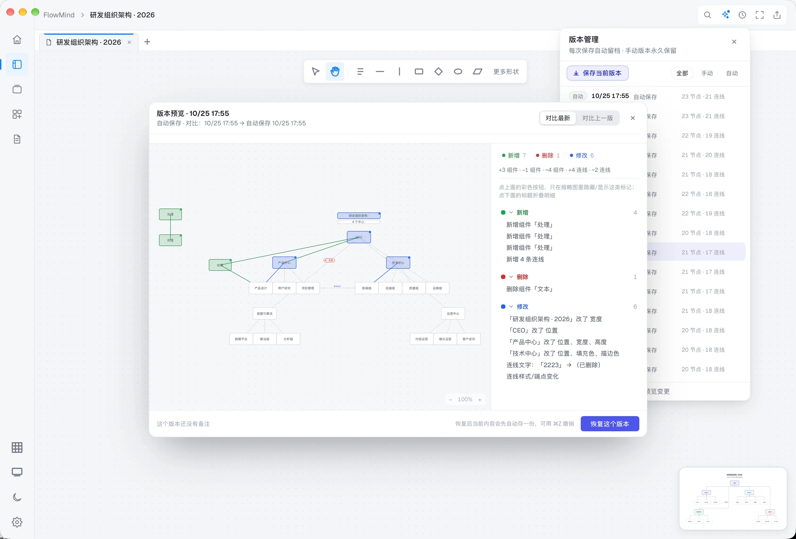
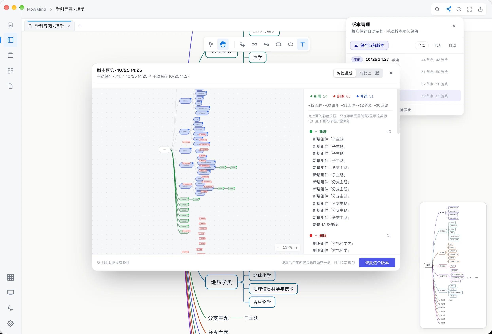
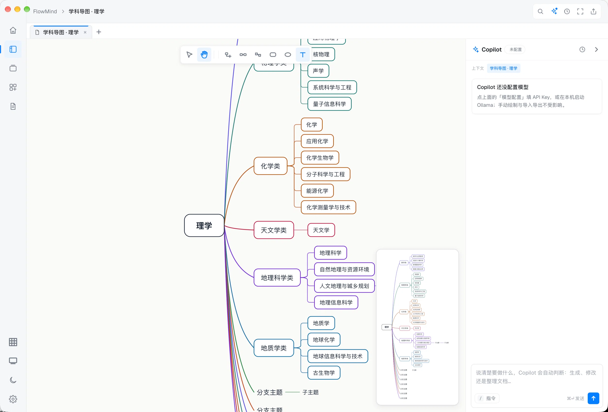

<div align="center">

[简体中文](README.md) · **English**


# FlowMind

**Draw your flowcharts. Keep them organised.**

Native macOS · local storage + iCloud backup · AI editing · Git version history · Agent-ready

[](#)
[](#)
[](#)
[](#)
[](#)
[](#privacy)

[Website](https://diqibadao.github.io/flowmind/) · [Privacy](https://diqibadao.github.io/flowmind/privacy.html) · [Support](https://diqibadao.github.io/flowmind/support.html)

</div>

---


## Screenshots

<p align="center">
  
</p>
<p align="center">
  
  
</p>
<p align="center">
  
  
</p>
<p align="center">
  
  
</p>
<p align="center">
  
</p>

## Seven things it does

| | Capability | What it means |
|---|---|---|
| 🗂 | **Personal library** | Every diagram in one place: thumbnail grid, search, favourites, rename, trash; 10+ templates plus your own |
| 💾 | **Local storage** | Diagrams are ordinary files in a folder you choose — visible in Finder, easy to back up, send or version |
| ☁️ | **iCloud backup** | Optional: each save copies the file into iCloud Drive. Apple handles transport and encryption; saving works offline |
| 🤖 | **AI built in** | One Copilot for generating, editing, optimising and writing docs; OpenAI-compatible or local Ollama; keys live in the Keychain |
| 🔌 | **MCP / Agents** | Claude Code, Codex and Cursor can create **editable** diagrams that land in your library, tagged as Agent-made |
| 🕘 | **Git version history** | Every save is committed; manual versions are kept forever and can be annotated |
| 🔍 | **Compare & roll back** | Three-colour diff (green added / red removed / blue changed) including connectors and labels; restore any version in one click |

## Also included

- **Formats**: import Mermaid, draw.io, Markdown, OPML, CSV, FreeMind; export SVG / PNG / PDF
- **Smart layout**: layered, tree and force layouts in one click
- **Structured canvas**: swimlanes, ER tables, mind maps, fishbone, org charts; 19 node types with orthogonal routing
- **Fine control**: align, distribute, equal spacing, z-order, lock, snapping, guides, unlimited undo
- **Solid**: multi-tab editing, autosave, draft recovery after a crash

## Why versioning matters here

The hard part of diagramming is not drawing — it is **recovering when an edit goes wrong**.

FlowMind commits every save into a local Git repository (one per diagram): automatic versions are de-duplicated by content, manual versions are kept forever. The diff view marks additions in green, deletions in red and changes in blue — connectors and their labels included. Pick any version and restore it in one click.

## Let an Agent draw for you

```bash
npx -y https://github.com/diqibadao/flowmind/releases/download/v0.7.0/flowmind-mcp-0.7.0.tgz
```

In FlowMind open **Settings → MCP → Copy setup prompt** and paste it into any Agent chat. It installs, registers, draws a test diagram and confirms the file landed. You just wait for “done”.

Tools: `create_diagram` / `list_documents` / `get_document` / `export_document` / `open_document`.
Local stdio only, no network ports; reads and writes only inside your library folder; Agent-made diagrams carry a badge so you can tell them apart.

## Shortcuts (excerpt)

| Action | Shortcut | Action | Shortcut |
|---|---|---|---|
| Command palette | `⌘K` | Smart layout | `⌘L` |
| New / Open / Save | `⌘N` / `⌘O` / `⌘S` | Export | `⌘E` |
| Undo / Redo | `⌘Z` / `⇧⌘Z` | Duplicate | `⌘D` |
| Copy as Mermaid | `⇧⌘C` | Edit text | `Enter` |
| Align (left/center/right…) | `⇧⌘L/C/R…` | Zoom 100% / fit | `⌘0` / `⌘9` |

## Privacy

- No account required
- No telemetry: no behaviour collection, no crash uploads, no analytics or ad SDKs
- Data stays local: diagrams are your files; AI keys live only in the Keychain
- AI is opt-in: requests go only to the model service **you** configured; with Ollama nothing leaves your Mac
- iCloud backup is handled by macOS; we run no servers

Full text: [Privacy Policy](https://diqibadao.github.io/flowmind/privacy.html).

## Roadmap

- [x] Library, templates, multi-format import/export
- [x] AI Copilot with diff preview
- [x] Git version history, three-colour diff, rollback
- [x] MCP integration (Agents draw directly)
- [ ] Mac App Store release
- [ ] Industry shape libraries (cloud architecture, network topology, wireframes)
- [ ] Complete Chinese/English UI coverage

## About this repository

This repository hosts the **product site, privacy policy, issue tracker and the MCP tool distribution**.
The FlowMind app source code is not part of this repository.

## Feedback

- [Report a bug](https://github.com/diqibadao/flowmind/issues/new?template=bug_report.yml) · [Request a feature](https://github.com/diqibadao/flowmind/issues/new?template=feature_request.yml)

---

<div align="center">

**FlowMind** — draw it clearly, change it safely.

</div>
